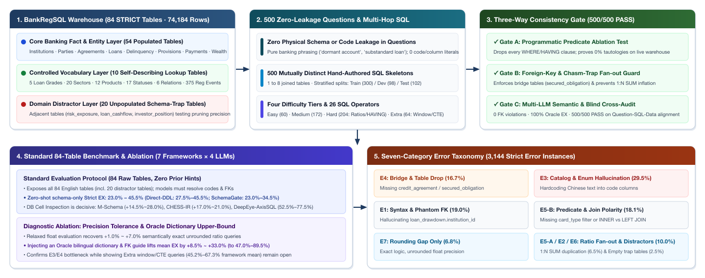

# BankRegBench: Controlled-Vocabulary & Multi-Hop Text-to-SQL over Enterprise Banking Regulatory Warehouses

<p align="center">
  <a href="#overview"></a>
  <a href="DATASET_CARD.md"></a>
  <a href="DATASET_CARD.md"></a>
  <a href="results/leaderboard_standard.md"></a>
  <a href="LICENSE"></a>
</p>

<p align="center">
  <b>English</b> | <a href="README_ZH.md">中文说明</a> | <a href="DATASET_CARD.md">Dataset Card</a>
</p>



---

## Overview

**BankRegBench** is an open-source, clean-room Text-to-SQL benchmark grounded in enterprise commercial banking supervision and compliance auditing. Rather than relying on shallow wide tables or per-question hint dumps, BankRegBench evaluates NL2SQL systems over an **84-table `STRICT` 3NF SQLite warehouse** (`74,184` deterministic rows, `0` foreign-key violations) with:

- **10+2 Self-Describing Controlled Vocabulary Tables**: Questions use pure banking terminology (e.g., *"substandard loan"*, *"dormant account"*, *"non-standardized credit asset"*) with **zero** physical table names, column names, or enum code literals leaked in the prompt.
- **20 Same-Domain Empty Distractor Tables**: Adjacent unpopulated tables (e.g., `risk_exposure`, `loan_cashflow`, `investor_position`) test schema linking and pruning robustness.
- **500 Hand-Authored Multi-Hop Bilingual Questions (ZH + EN, 100% Distinct SQL Skeletons)**: Covering **64/64 (100%)** populated tables, spanning **1 to 8 joined tables**, 4 difficulty tiers (`Easy` 60 / `Medium` 172 / `Hard` 204 / `Extra` 64), and 26 SQL operators (`CTE`, `WINDOW`, `HAVING`, `SELF_JOIN`, `EXISTS`, `RATIO`, etc.). Both Chinese (`question`) and parallel English (`question_en`) questions pass programmatic zero-leakage assertions.
- **Three-Way Consistency Quality Gate (500/500 PASS)**: Every item passes programmatic predicate ablation (`0%` tautological `WHERE`/`HAVING` clauses), 1:N chasm-trap fan-out checks, determinism checks, and semantic consistency verification.
- **Zero-Cost Offline Reproducibility**: All **56 anonymized benchmark prediction files** (`28` Standard Track L0 + `28` Oracle Dictionary Ablation Track L2) are shipped under `results/` so anyone can verify every metric and all **3,144** error taxonomy instances offline in seconds with **Python standard library only**.

---

## Repository Structure

```text
BankRegBench/
├── README.md                          # English overview & quickstart (this file)
├── README_ZH.md                       # Chinese documentation
├── DATASET_CARD.md                    # Detailed schema, splits, licensing & quality gates
├── LICENSE                            # Apache-2.0 License
├── THIRD_PARTY_NOTICES.md             # Attribution for M-Schema, SchemaGate & baseline frameworks
├── configs/models.example.json        # OpenAI-Compatible multi-model configuration template
├── schema/bankreg_v4.sqlite.sql       # 84-table STRICT 3NF DDL
├── data/
│   ├── bankreg.sqlite                 # Deterministic 84-table warehouse (74,184 rows, 0 FK violations)
│   ├── questions.jsonl                # 500 questions + Gold SQL + frozen answers + Train/Dev/Test splits
│   ├── schema.json                    # Machine-readable schema, FKs, row counts & catalog domains
│   ├── dataset_stats.json             # Dataset structural statistics
│   ├── validation_report.json         # Independent 10-group validation report (0 failures)
│   ├── audit_summary.json             # 3-way consistency gate summary (500/500 PASS)
│   └── bird_format/                   # Clean text-only BIRD-compatible export
├── src/                               # Deterministic dataset builder, validator, auditor & BIRD exporter
├── eval/                              # OpenAI-Compatible client, dual-metric scorer, Track L0/L2 harnesses & taxonomy
├── third_party/m_schema/              # Minimal Apache-2.0 M-Schema helper (~28 KB)
├── results/                           # Verified leaderboards, ablation reports & 56 anonymized prediction JSONLs
└── scripts/                           # One-click dataset reproduction, offline verification & eval runners
```

---

## Quickstart (Zero External Dependencies)

Core dataset reproduction, independent validation, programmatic auditing, offline scoring, and error taxonomy reproduction require **only Python >= 3.10 standard library**.

```bash
git clone https://github.com/anonymous/BankRegBench.git
cd BankRegBench
```

### 1. Reproduce & Validate the Entire Dataset End-to-End (~5 seconds)

```bash
bash scripts/reproduce_dataset.sh
```

This deterministically rebuilds `data/bankreg.sqlite` (`SEED=20260630`), executes all 500 gold queries, verifies 10 independent validation assertions (`FAILURES: 0`), runs programmatic predicate-ablation & fan-out auditing (`0` warnings), and self-tests the evaluator (`Oracle EX = 100.00%`, `Empty EX = 0.00%`).

### 2. Verify All Paper Results Offline (Zero API Cost, ~5 seconds)

```bash
bash scripts/verify_results.sh
```

This re-scores all **56 shipped prediction files** (`results/predictions_standard/` & `results/predictions_oracle_ablation/`), reproduces both leaderboards (`results/leaderboard_standard.md`, `results/ablation_oracle_dict.md`), updates the ablation summary (`results/ablation_summary.md`), and regenerates the 7-category error taxonomy (`3,144` strict failures across `5,600` evaluations).

### 3. Score Your Own Predictions

Format your predictions as JSONL (`{"question_id": "BRB2-0001", "predicted_sql": "SELECT ..."}`) and run:

```bash
python3 eval/evaluate.py \
  --predictions path/to/your_preds.jsonl \
  --split dev test
```

### 4. Run Online Evaluation on Any OpenAI-Compatible LLM

Five frameworks (`direct_ddl`, `m_schema`, `dail_sql`, `chess`, `deepeye_axissql`) run out of the box with **Python standard library only** (powered by our built-in pure-SQLite M-Schema engine). To also run `schemagate` and `rsl_sql`, install `schemagate`:

```bash
pip install -r requirements-eval.txt
```

Configure credentials via environment variables (or copy `configs/models.example.json` to `configs/models.json`):

```bash
export OPENAI_BASE_URL="https://api.openai.com/v1"
export OPENAI_API_KEY="your-api-key"
export OPENAI_MODEL="gpt-4o"

# Standard 84-Table Zero-Prior Evaluation (Track L0) — Chinese (default) or English
bash scripts/run_eval.sh standard m_schema gpt-4o zh
bash scripts/run_eval.sh standard m_schema gpt-4o en

# Oracle Dictionary Ablation (Track L2)
bash scripts/run_eval.sh ablation direct_ddl gpt-4o zh
```

> **Note for external BIRD-format frameworks**: Run `python3 src/export_bird_format.py --copy-db` if your framework expects a local SQLite copy inside `data/bird_format/dev_databases/bankreg_main/`.

---

## Official Benchmark Results (Held-Out `Dev+Test`, `N = 200`)

### 1. Standard 84-Table Zero-Prior Evaluation (Track L0 — Top 10 / 28 Configurations)

Full 28-configuration leaderboard: [`results/leaderboard_standard.md`](results/leaderboard_standard.md).

| Rank | Framework | Backbone LLM | Relaxed EX (%) | Strict EX (%) | Dev EX (%) | Test EX (%) | Executable (%) | Easy (%) | Medium (%) | Hard (%) | Extra (%) | Latency (s) |
| :--: | :--- | :--- | ---: | ---: | ---: | ---: | ---: | ---: | ---: | ---: | ---: | ---: |
| 1 | `deepeye_axissql` | `DeepSeek-V4.1-Flash` | **84.50** | 77.50 | 86.73 | 82.35 | 100.00 | 87.50 | 82.61 | 87.65 | 76.92 | 2.84 |
| 2 | `m_schema` | `DeepSeek-V4.1-Flash` | **80.00** | 73.50 | 80.61 | 79.41 | 97.50 | 83.33 | 79.71 | 81.48 | 73.08 | 4.43 |
| 3 | `chess` | `DeepSeek-V4.1-Flash` | **74.00** | 67.00 | 76.53 | 71.57 | 99.50 | 79.17 | 71.01 | 72.84 | 80.77 | 7.59 |
| 4 | `deepeye_axissql` | `DeepSeek-V4-Flash` | **63.00** | 58.50 | 65.31 | 60.78 | 97.50 | 70.83 | 71.01 | 60.49 | 42.31 | 3.03 |
| 5 | `deepeye_axissql` | `Qwen3.5-397B-A17B` | **63.00** | 57.00 | 60.20 | 65.69 | 94.00 | 79.17 | 59.42 | 62.96 | 57.69 | 3.39 |
| 6 | `dail_sql` *(Disjoint)* | `DeepSeek-V4.1-Flash` | **59.50** | 55.00 | 60.20 | 58.82 | 98.50 | 62.50 | 63.77 | 59.26 | 46.15 | 5.42 |
| 7 | `deepeye_axissql` | `Qwen3.6-35B-A3B` | **58.00** | 52.50 | 59.18 | 56.86 | 93.50 | 62.50 | 53.62 | 61.73 | 53.85 | 1.91 |
| 8 | `chess` | `DeepSeek-V4-Flash` | **55.50** | 50.00 | 58.16 | 52.94 | 96.50 | 58.33 | 56.52 | 54.32 | 53.85 | 13.74 |
| 9 | `m_schema` | `Qwen3.6-35B-A3B` | **53.00** | 49.00 | 59.18 | 47.06 | 85.00 | 62.50 | 52.17 | 53.09 | 46.15 | 11.86 |
| 10 | `rsl_sql` | `DeepSeek-V4.1-Flash` | **52.50** | 49.50 | 58.16 | 47.06 | 99.00 | 58.33 | 56.52 | 49.38 | 46.15 | 6.45 |

### 2. Diagnostic Ablation: Standard Track L0 vs. Oracle Dictionary Track L2

Full comparison & error taxonomy: [`results/ablation_summary.md`](results/ablation_summary.md) and [`results/error_taxonomy_summary.md`](results/error_taxonomy_summary.md).

| Framework | Standard Strict EX (%) | Standard Relaxed EX (%) | +Oracle Dict EX (%) | Δ Gain (vs. Strict) | +Oracle Dict Extra EX (%) |
| :--- | ---: | ---: | ---: | ---: | ---: |
| `schemagate` | 26.12% | 28.00% | 59.12% | **+33.00%** | 45.20% |
| `direct_ddl` | 33.00% | 36.00% | 62.75% | **+29.75%** | 49.04% |
| `rsl_sql` | 37.38% | 40.38% | 68.12% | **+30.75%** | 57.69% |
| `dail_sql` | 43.50% | 46.88% | 65.00% | **+21.50%** | 47.11% |
| `chess` | 52.12% | 57.12% | 64.38% | **+12.25%** | 57.69% |
| `m_schema` | 53.50% | 58.12% | 61.88% | **+8.38%** | 50.96% |
| `deepeye_axissql` | 61.38% | 67.12% | 76.12% | **+14.75%** | 67.31% |

---

## License & Ethics

BankRegBench is a **100% clean-room synthetic benchmark**. It contains zero real bank customer data, zero PII, and zero proprietary reporting schemas. All data rows are deterministically synthesized from public banking regulatory concepts and administrative compliance rules. Released under the [Apache-2.0 License](LICENSE).

---

## Citation

```bibtex
@inproceedings{anonymous2026bankregbench,
  title     = {BankRegBench: Evaluating Controlled-Vocabulary and Multi-Hop Text-to-SQL over Enterprise Banking Regulatory Warehouses},
  author    = {Anonymous Authors},
  booktitle = {Under Review},
  year      = {2026}
}
```
