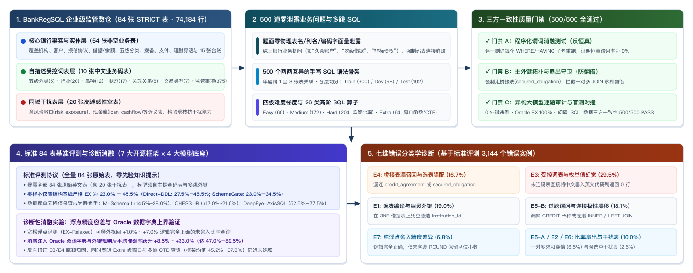

# BankRegBench：面向受控词表与多跳推理的企业级银行监管数仓 Text-to-SQL 评测基准

<p align="center">
  <a href="README.md">English</a> | <b>中文说明</b> | <a href="DATASET_CARD.md">Dataset Card</a>
</p>



---

## 项目简介

**BankRegBench** 是一个面向商业银行合规稽核与监管数仓场景的纯开源、洁净室（clean-room）Text-to-SQL 评测基准。项目基于 **84 张 `STRICT` 3NF 规范化 SQLite 监管数仓**（`74,184` 行确定性模拟数据，`0` 外键违例）与 **500 道零物理泄露多跳监管问题** 构建：

- **10+2 张库内自描述受控词表（码表）**：题面完全采用银行业务中文表述（如“久悬账户”、“次级借据”、“非标准化债权类资产”），**零物理表名、零物理列名、零枚举代码泄露**，考察模型主动探查单元格或编写码表 `JOIN` 的能力。
- **20 张同域未填充干扰表**：内置 `risk_exposure`、`loan_cashflow`、`investor_position` 等近义干扰表，检验 Schema 剪枝与抗噪能力。
- **500 道手写中英双语多跳问题（100% 互异 SQL 骨架）**：100% 覆盖全部 **64/64** 张非空业务与码表；每题同时提供中文原题（`question`）与零泄露专业金融英文并行版本（`question_en`）；单题跨 **1–8 表连接**；四档难度（`Easy` 60 / `Medium` 172 / `Hard` 204 / `Extra` 64），覆盖 26 类高阶 SQL 算子；固定分层切分为 `Train 300 / Dev 98 / Test 102`。
- **三方一致性质量门禁（500/500 PASS）**：全部 500 题通过程序化谓词消融（`0%` 恒真谓词）、一对多扇出守卫与语义一致性审查。
- **零 API 费用一键离线复核**：仓库已附带全部 **56 组脱敏后的基准预测 SQL 文件**（28 组标准 84 表盲测 + 28 组 Oracle 数据字典消融），仅凭 Python 标准库即可在 5 秒内离线复核全部榜单分数与 3,144 例七维错误分类学结论。

---

## 目录结构

```text
BankRegBench/
├── README.md                          # 英文主文档
├── README_ZH.md                       # 本中文文档
├── DATASET_CARD.md                    # 数据集卡片（Schema、切分、合规声明与质量门禁）
├── LICENSE                            # Apache-2.0 开源协议
├── THIRD_PARTY_NOTICES.md             # 第三方开源框架声明与致谢
├── configs/models.example.json        # 标准 OpenAI-Compatible 多模型配置模板
├── schema/bankreg_v4.sqlite.sql       # 84 张 STRICT 3NF 表完整建表 DDL
├── data/
│   ├── bankreg.sqlite                 # 确定性 84 表 SQLite 数仓（74,184 行，0 外键违例）
│   ├── questions.jsonl                # 500 题零泄露问题 + Gold SQL + 冻结答案 + Train/Dev/Test 切分
│   ├── schema.json                    # 结构化 Schema、外键、行数与受控词表值域
│   ├── dataset_stats.json             # 数据集结构分布统计
│   ├── validation_report.json         # 10 项独立验证报告（0 failures）
│   ├── audit_summary.json             # 三方一致性质量门禁汇总（500/500 PASS）
│   └── bird_format/                   # 精简纯文本 BIRD 标准格式导出
├── src/                               # 数仓构建、数据集打包、独立校验、质量审计与 BIRD 导出源码
├── eval/                              # OpenAI-Compatible 客户端、双口径打分引擎、Track L0/L2 管线与错误分析
├── third_party/m_schema/              # 精简版 M-Schema 辅助模块（Apache-2.0，仅 ~28 KB）
├── results/                           # 脱敏且可 100% 离线核验的主榜、消融报告与 56 组逐题预测 SQL
└── scripts/                           # 一键重建数据集、离线核验结果与运行在线评测的脚本
```

---

## 快速开始（核心流程零第三方依赖）

数据集重建、10 项独立校验、程序化质量审计、离线评分与错误分类学分析**仅需 Python >= 3.10 标准库**。

```bash
git clone https://github.com/anonymous/BankRegBench.git
cd BankRegBench
```

### 1. 一键确定性重建并验证完整数据集（~5 秒）

```bash
bash scripts/reproduce_dataset.sh
```

脚本将依次完成：生成 84 表数仓（`SEED=20260630`）→ 执行 500 道 Gold SQL 并冻结答案 → 导出 BIRD 格式 → 运行 10 项独立校验（`FAILURES: 0`）→ 运行程序化谓词消融/扇出审计（`0` 告警）→ 自检打分引擎（`Oracle EX = 100.00%`、`Empty EX = 0.00%`）。

### 2. 零 API 费用离线核验全部论文实验结果（~5 秒）

```bash
bash scripts/verify_results.sh
```

脚本将基于 `results/predictions_standard/`（28 组）与 `results/predictions_oracle_ablation/`（28 组）离线重算全部指标、生成排行榜与消融对比报告，并复现 3,144 例七维错误分类学统计。

### 3. 对自定义模型预测结果进行打分

准备 JSONL 文件（每行包含 `{"question_id": "BRB2-0001", "predicted_sql": "SELECT ..."}`），执行：

```bash
python3 eval/evaluate.py \
  --predictions path/to/your_preds.jsonl \
  --split dev test
```

### 4. 在线复现 / 评测新的大模型与开源框架

内置纯标准库 SQLite M-Schema 引擎，**无需任何第三方包**即可直接在线运行 `direct_ddl`、`m_schema`、`dail_sql`、`chess`、`deepeye_axissql` 共 **5/7 大框架**；如需运行 `schemagate` 和 `rsl_sql`，安装轻量可选依赖即可：

```bash
pip install -r requirements-eval.txt
```

通过环境变量配置任意 OpenAI-Compatible API（或复制 `configs/models.example.json` 为 `configs/models.json` 配置多模型矩阵），支持 `--lang zh`（默认中文）与 `--lang en`（英文问题评测）：

```bash
export OPENAI_BASE_URL="https://api.openai.com/v1"
export OPENAI_API_KEY="your-api-key"
export OPENAI_MODEL="gpt-4o"

# 标准 84 表零先验评测（Track L0）：中文 / 英文
bash scripts/run_eval.sh standard m_schema gpt-4o zh
bash scripts/run_eval.sh standard m_schema gpt-4o en

# Oracle 数据字典消融评测（Track L2）
bash scripts/run_eval.sh ablation direct_ddl gpt-4o zh
```

---

## 核心实验结果速览（留出集 `Dev+Test`, `N = 200`）

完整 28 组主榜见 [`results/leaderboard_standard.md`](results/leaderboard_standard.md)，Oracle 消融对比见 [`results/ablation_summary.md`](results/ablation_summary.md)，3,144 例七维错误分类学报告见 [`results/error_taxonomy_summary.md`](results/error_taxonomy_summary.md)。

| 排名 | 开源框架 | 模型底座 | 宽松 EX (%) | 严格 EX (%) | Dev EX (%) | Test EX (%) | 可执行率 (%) | Easy (%) | Medium (%) | Hard (%) | Extra (%) | 耗时 (s) |
| :--: | :--- | :--- | ---: | ---: | ---: | ---: | ---: | ---: | ---: | ---: | ---: | ---: |
| 1 | `deepeye_axissql` | `DeepSeek-V4.1-Flash` | **84.50** | 77.50 | 86.73 | 82.35 | 100.00 | 87.50 | 82.61 | 87.65 | 76.92 | 2.84 |
| 2 | `m_schema` | `DeepSeek-V4.1-Flash` | **80.00** | 73.50 | 80.61 | 79.41 | 97.50 | 83.33 | 79.71 | 81.48 | 73.08 | 4.43 |
| 3 | `chess` | `DeepSeek-V4.1-Flash` | **74.00** | 67.00 | 76.53 | 71.57 | 99.50 | 79.17 | 71.01 | 72.84 | 80.77 | 7.59 |
| 4 | `deepeye_axissql` | `DeepSeek-V4-Flash` | **63.00** | 58.50 | 65.31 | 60.78 | 97.50 | 70.83 | 71.01 | 60.49 | 42.31 | 3.03 |
| 5 | `deepeye_axissql` | `Qwen3.5-397B-A17B` | **63.00** | 57.00 | 60.20 | 65.69 | 94.00 | 79.17 | 59.42 | 62.96 | 57.69 | 3.39 |

---

## 合规声明与开源协议

BankRegBench 采用**100% 洁净室合成设计**，不包含任何真实银行客户信息、个人隐私数据（PII）或非公开内部报送表结构。全部代码与数据集基于 [Apache-2.0](LICENSE) 协议开源。

---

## 引用格式（匿名审稿占位）

```bibtex
@inproceedings{anonymous2026bankregbench,
  title     = {BankRegBench: Evaluating Controlled-Vocabulary and Multi-Hop Text-to-SQL over Enterprise Banking Regulatory Warehouses},
  author    = {Anonymous Authors},
  booktitle = {Under Review},
  year      = {2026}
}
```
